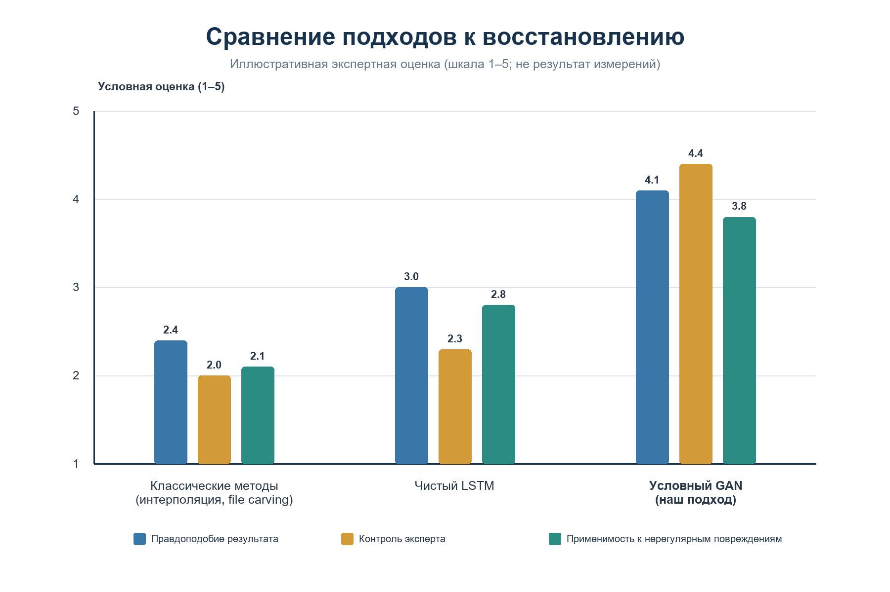
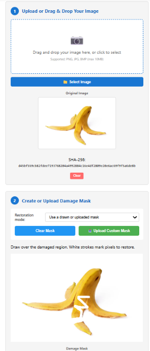
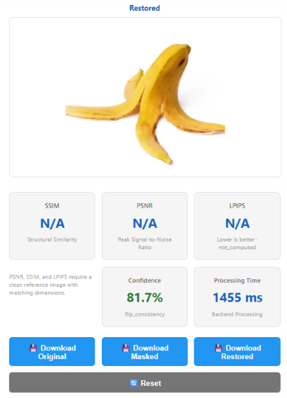
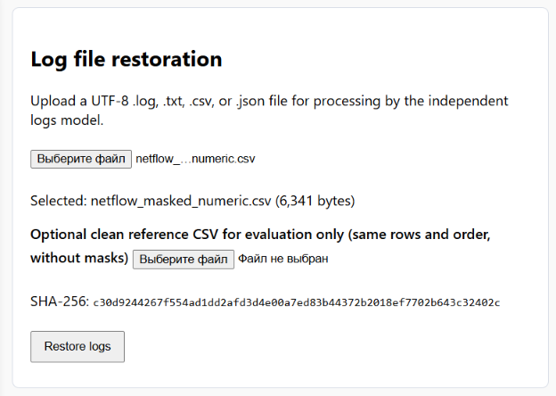
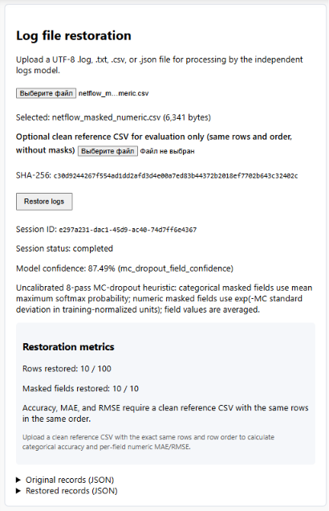
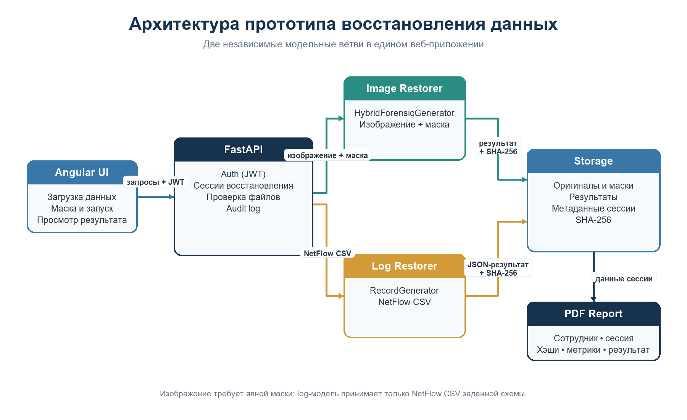
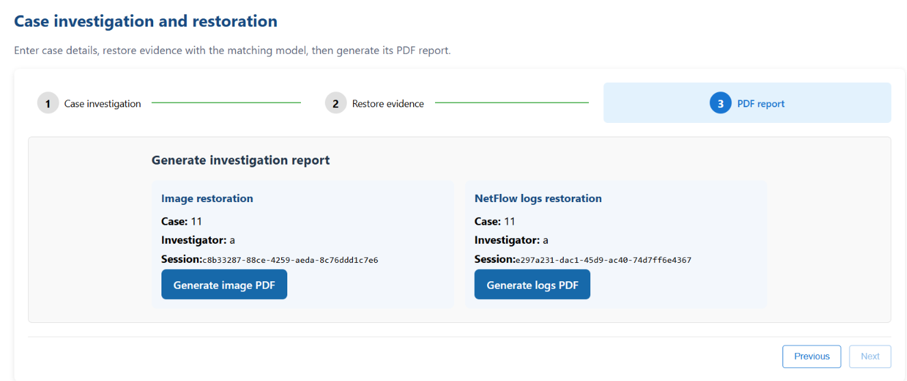
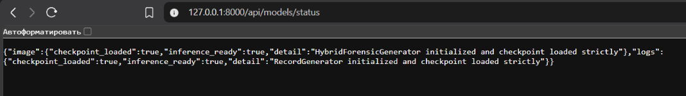
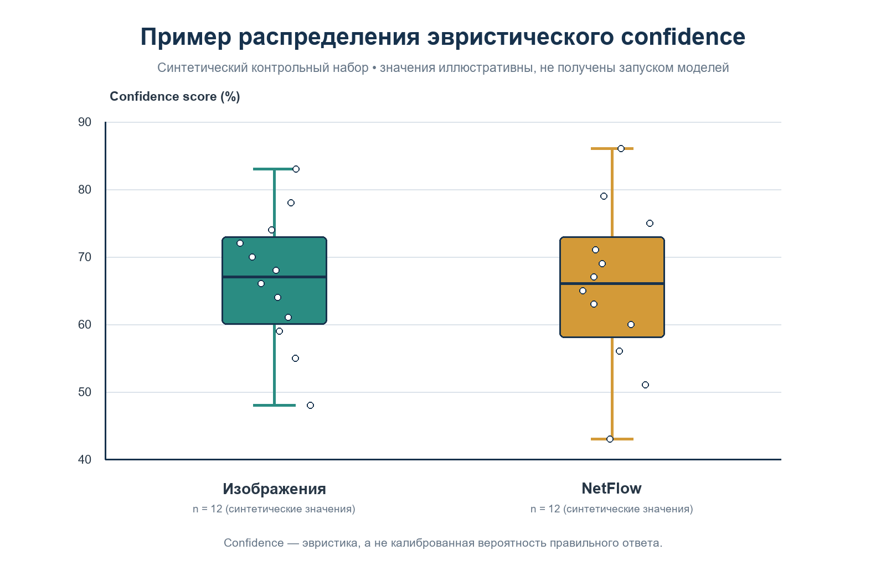

# ОТЧЁТ
# О ВЫПОЛНЕНИИ ПРОГРАММЫ ИССЛЕДОВАТЕЛЬСКОЙ ПРАКТИКИ

**Магистрант:** Хегай Владислав Владимирович  
**Образовательная программа:** 7M06105 Computer Science and Engineering  
**Группа:** CSE-2502M  
**База практики:** НИЦ «CyberTech» Astana IT University  
**Руководитель практики:** Туткышбаева Шырын Сарыбайевна  
**Руководитель базы практики:** Рзаева Лейла Гумметовна  
**Период прохождения практики:** с 7 сентября 2026 г. по 14 ноября 2026 г.  
**Тема магистерской диссертации:** Интеллектуальная криминалистическая платформа на основе GAN-моделей для восстановления повреждённых цифровых доказательств  
**Учебный год:** 2026–2027, первый триместр

---

# ВВЕДЕНИЕ

Настоящий отчёт подготовлен по итогам прохождения магистрантом Хегай Владиславом Владимировичем программы исследовательской практики в первом триместре 2026–2027 учебного года. Практика проходила с 7 сентября по 14 ноября 2026 года на базе НИЦ «CyberTech» Astana IT University. Основным объектом работы являлось создание программного прототипа для восстановления повреждённых цифровых данных с применением генеративных и условных моделей машинного обучения.

Практическая деятельность была организована вокруг двух содержательно независимых, но технологически объединённых задач. Первая задача предусматривает восстановление повреждённого изображения в условиях, когда пользователь заранее определяет область повреждения посредством маски. Вторая задача предусматривает восстановление отдельных пропущенных или повреждённых полей в структурированных сетевых журналах формата NetFlow. Для обеих ветвей разработаны адаптеры инференса, пользовательский интерфейс, серверная часть и единая система фиксации операций.

Тема практики соответствует современным направлениям цифровой криминалистики и машинного обучения. В настоящее время аудио-, видео-, графические и сетевые доказательства всё чаще обрабатываются с применением автоматизированных средств. Одновременно с этим растут требования к воспроизводимости экспертизы, сохранению исходных данных, фиксации действий специалиста и контролируемости результатов. В этой связи сам факт получения восстановленного изображения или заполненной записи недостаточен для практического применения. Необходимо сохранять исходные файлы, маски, эталонные данные, идентификаторы сессий, временные метки и хеши, чтобы восстановленный объект не был оторван от контекста его получения.

Цель работы заключалась не в создании универсальной системы криминалистического восстановления, а в разработке исследовательского прототипа, позволяющего последовательно проверить архитектуры и интеграционные механизмы. В ходе практики формировались следующие представления о границах системы: она должна принимать задаваемую пользователем маску изображения, обрабатывать только NetFlow CSV фиксированной схемы, сохранять все входные и выходные объекты, а также отличать операционное восстановление от режима оценки качества по чистому эталону. Эти границы позволили избежать преждевременной претензии на универсальность и обеспечить честное описание возможностей прототипа.

# Глава 1. ОБЩИЕ СВЕДЕНИЯ О ПРАКТИКЕ

## 1.1. Тема, объект и предмет исследования

Тема практической работы определена как разработка прототипа восстановления цифровых доказательств на основе генеративных нейросетевых моделей. Объектом исследования являются повреждённые изображения и маскированные записи сетевого трафика. Предметом исследования являются архитектуры восстановительных моделей, процедуры предобработки, методы оценки качества, а также программная архитектура интеграции моделей в веб-приложение.

Практическое развитие проекта охватывает две технические ветви. Первая ветвь использует архитектуру HFI-GAN с генератором `HybridForensicGenerator`, адаптированную для масочного восстановления изображения. Вторая ветвь использует условный генератор `RecordGenerator`, загружающий конфигурацию и словари из чекпоинта модели NetFlow. Обе ветви объединяются в единый backend на FastAPI и пользовательский интерфейс на Angular.

## 1.2. Цели и задачи практики

Целью практики являлось получение работоспособного программного прототипа с реальными checkpoint-файлами и прослеживаемой последовательностью обработки данных.

Для достижения цели решались следующие задачи:

во-первых, уточнить требования к прототипу и отделить реализуемую функциональность от перспективных возможностей;

во-вторых, изучить структуру исходных архитектур и форматы обученных весов;

в-третьих, реализовать независимые адаптеры инференса для изображения и NetFlow;

в-четвёртых, интегрировать инференс с аутентификацией, загрузкой файлов, SQLite, аудитом и генерацией отчётов;

в-пятых, обеспечить отображение результатов и метрик в интерфейсе;

в-шестых, сформировать минимальные тестовые сценарии загрузки и восстановления;

в-седьмых, документировать ограничения и подготовить материалы для последующих экспериментов.

## 1.3. База практики и используемые технологии

Практическая работа выполнялась на базе научно-исследовательского центра «CyberTech» Astana IT University. Технической основой являлся локальный проект GAN-main. Его основная структура разделена на три логически значимые части. Папка `backend/` содержит API и серверную логику. Папка `models/` содержит исходники архитектур и контрольные точки. Папка `src/` содержит Angular-приложение.

На фронтенд-уровне использованы Angular 18, TypeScript, RxJS и Angular HTTP Client. Пользовательский интерфейс поддерживает загрузку файлов, рисование маски на canvas, получение результатов и запуск генерации PDF. JWT-токен сохраняется в браузере и передаётся backend-посредством HTTP interceptor.

На backend-уровне использованы FastAPI, SQLAlchemy, Pydantic и SQLite. В качестве основного формата хранения по умолчанию применяется SQLite-файл `backend/data/app.db`. Конфигурация backend позволяет использовать PostgreSQL без переработки клиентского кода, так как доменная логика построена на SQLAlchemy.

На уровне машинного обучения применён PyTorch для загрузки и запуска обеих сетей. Для генерации PDF используется ReportLab. Хеширование реализовано с помощью SHA-256. Все загруженные и созданные файлы сохраняются в `backend/storage/`, а связанные метаданные записываются в таблицы базы данных.

## 1.4. Организация практической работы по этапам

Работа в первом триместре была распределена по последовательным этапам подготовки, анализа, выбора методологии, реализации, интеграции и проверки. Подготовительный этап включал ознакомление с структурой репозитория, назначением существующих компонентов Angular и форматом двух наборов checkpoint-файлов. Аналитический этап был направлен на уточнение возможности реального инференса и различение существующего исходного кода от недостающих блоков интеграции.

В рамках подготовительного этапа было установлено, что для визуальной ветви доступна архитектура `HybridForensicGenerator`, а для сетевой ветви доступен исходник `train_log_gan.py` с модельным классом `RecordGenerator`. Одновременно было установлено отсутствие универсального формата входных данных между двумя моделями. Поэтому их нельзя было объединить в единый adapter или передавать через один некорректный endpoint. Каждая ветвь получила собственную проверку входа, собственный формат результата и собственный набор метрик.

На аналитическом этапе определялись риски переноса картинки и логов в один интерфейс без явного разделения областей ответственности. Основное решение состояло в том, чтобы на уровне backend образовались две независимые сессии с собственным типом, моделью и ссылкой на исходный файл. На уровне Angular изображения и NetFlow представлены отдельными компонентами, хотя оба могут размещаться внутри общего workflow-степпера.

Методологический этап включал формирование правил повреждения и оценки. Для изображений правило основано на маске и пороге пикселя. Для NetFlow правило основано на маркерном заполнении `<MASK>`. В обоих случаях регистрируется разница между исходным и восстановленным объектом, а эталонный материал рассматривается как необязательный дополнительный артефакт оценки.

Экспериментальный этап состоял в последовательной загрузке чекпоинтов, запуске smoke-тестов и исправлении несогласованности форматов. Интеграционный этап завершил создание единой системы, в которой upload, инференс, сохранение результата, session-state и PDF выполняются через REST-интерфейсы. Таким образом, практику можно рассматривать как переход от набора отдельных модельных материалов к контролируемому программному прототипу.

## 1.5. Использование иллюстраций и отчётного материала

Для наглядного представления результата в отчёте приведены реальные снимки интерфейса из каталога `screenshoots/` и отдельные иллюстративные графики. Сравнительные баллы на диаграмме подходов являются условной экспертной визуализацией, а значения confidence на синтетическом наборе не получены запуском моделей. Эти изображения не следует трактовать как результаты сравнительного эксперимента.

Экранные снимки демонстрируют пользовательский сценарий и состояние локального интерфейса, а схемы и графики поясняют архитектуру и методические ограничения. Иллюстративные данные отдельно помечаются и не представляются как фактические показатели эмпирического эксперимента.

# Глава 2. ВВЕДЕНИЕ И АКТУАЛЬНОСТЬ

## 2.1. Повреждённые цифровые доказательства

Повреждение цифровых доказательств может иметь разные происхождение и признаки. Визуальные данные могут содержать неинформативные области, наложения, царапины, редактирования или потери пиксельной информации. Сетевые журналы могут содержать пропущенные поля, некорректные значения или фрагменты записей, утраченные в процессе сбора или передачи. В обоих случаях задача восстановления связана не только с созданием визуально или синтаксически допустимого объекта, но и с сохранением правдоподобия без необоснованной модификации достоверной части данных.

Для цифрового следователя восстановление важно тем, что может повысить читаемость доказательств и облегчить последующий анализ. Однако в прикладной криминалистике нельзя считать восстановленную область фактически установленной истиной. Восстановление представляет собой гипотетическую интерпретацию исходных данных на основе обученного распределения. Поэтому восстановленный фрагмент должен явно отделяться от исходного материала и сопровождаться метаданными о модели, маске, сессии и отсутствии или наличии эталона.

## 2.2. Ограничения классических методов

Классические методы обработки изображений часто выполняют интерполяцию соседних пикселей или перенос текстурного фрагмента в повреждённую область. Такие методы могут давать полезный результат для небольших и простых областей. Вместе с тем они не всегда способны воспроизводить сложную геометрию, семантику объектов и большие пропуски. Ручное редактирование требует высокого уровня экспертизы и не всегда воспроизводимо в автоматическом режиме.

File carving и восстановление фрагментов файлов решают другую задачу — поиск и сбор фрагментов по структуре формата или сигнатурам. Эти методы не являются универсальным inpainting-методом для произвольных семантических повреждений в изображении. В контексте последовательных логов простые статистические или детерминированные замены могут исказить распределение сетевого потока, нарушить зависимости между полями или заменить редкие значения в результате усреднения.

Чистая LSTM-модель может использовать временный контекст для последовательностей фиксированной длины, но в исходной постановке проекта также возникали ограничения структуры и значений. В частности, для NetFlow отдельная запись содержит одновременно категориальные и числовые поля. Чистая авторегрессионная логика может недостаточно точно учитывать многопольную структуру записи или требовать сложного набора правил для числовых и категориальных типов.

## 2.3. Мотивация генеративных подходов

Генеративные модели позволяют учитывать более широкий контекст и моделировать распределение возможных результатов вместо единственного детерминистического заполнения. Для изображения контекстная агрегация и gated-пути могут сохранять детали исходного фона и создавать согласованную область в повреждённой маске. Для NetFlow условный генератор может одновременно предсказывать категориальные и числовые поля в рамках соседнего контекста.

При этом генеративное восстановление неизбежно связано с феноменом галлюцинации. Модель может создать правдоподобный, но фактически неверный объект. Поэтому в проекте результат генерации не подменяет исходный файл и не перезаписывает его. Результат сохраняется как отдельная модельная интерпретация с собственным SHA-256, а PDF-отчёт содержит связь оригинала, маски или эталона и восстановления.

## 2.4. Криминалистический принцип прослеживаемости

Практическая постановка требует обеспечения прослеживаемости всей цепочки операций. В прототипе прослеживаемость реализуется на нескольких уровнях:

во-первых, SHA-256 фиксирует состояние загруженного оригинала и сгенерированного результата;

во-вторых, сессия связывает пользователя, исходный файл, маску, необязательный reference и модельный результат;

в-третьих, audit log фиксирует HTTP-запросы и предметные события запуска и завершения инференса;

в-четвёртых, временные метки фиксируют момент начала и завершения восстановления;

в-пятых, PDF-отчёт содержит данные сессии, хеши и доступные метрики.

Такой подход не доказывает содержание результата, но делает операцию проверяемой, повторяемой и связанной с конкретным пользователем.

# Глава 3. АНАЛИТИЧЕСКИЙ ОБЗОР

## 3.1. Context Encoders и изучение контекста

Одним из ранних подходов к семантическому заполнению пропусков стали context encoders, предложенные D. Pathak и соавторами в 2016 году. Основная идея заключалась в том, чтобы обучить сеть понимать видимую область изображения и предсказывать отсутствующую область по её контексту. В отличие от простого размытия или копирования соседства, context encoder использует adversarial и reconstruction objectives для генерации семантически согласованного заполнения.

Для настоящего прототипа важна не буквальная реализация context encoder, а общая методологическая идея: восстановление должно учитывать содержательный контекст, а не только геометрию краёв маски. Архитектура `HybridForensicGenerator` в разных уровнях использует кодирование изображения и маски, агрегацию контекста, shallow-путь сохранения деталей и декодирование.

Важное ограничение подхода заключается в том, что качество невозможно считать однозначно установленным по виду результата. Контекстная модель может создать визуально правдоподобный объект, который не соответствует исходной реальности. В рамках цифровой экспертизы модельная реконструкция должна рассматриваться как аналитическая гипотеза.

## 3.2. Gated convolutions

Ю и соавторы предложили gated convolutions как механизм для адаптивного использования пикселей в процессе заполнения повреждённой области. Динамически обучаемые gates позволяют сети различать значения в известной области и неопределённость внутри маски. Позднейшие архитектуры использовали CoModGAN и похожие механизмы модульной генерации. Для проекта принцип gated-связей является особенно значимым, поскольку маска передаётся вместе с входным изображением.

В исходной архитектуре HFI-GAN от данного проекта используются gated residual blocks и attention-механизмы на нескольких этапах. Маска влияет на обработку признаков и может ограничивать перенос повреждённых данных в skip-связи. На выходе известные пиксели копируются обратно из исходного изображения, а генеративное значение применяется только к маскированной области. Это снижает риск бесконтрольного изменения вне области экспертиза.

Несмотря на это, copy-through известной области не гарантирует отсутствие артефактов на границе маски. Граница остаётся зоной семантического и оценочного риска. Поэтому маска должна задаваться корректно, с учётом всей повреждённой области и без произвольного добавления заведомо валидных участков.

## 3.3. AOT-GAN

AOT-GAN, представленный Zeng и соавторами в рамках исследований генеративного inpainting, использует агрегирование контекстного внимания по разным диапазонам и разным пространственным масштабам. Основная идея состоит в использовании информации по всей изображению для заполнения пропуска с сохранением структуры и текстур.

В рамках проекта использована адаптированная архитектура `HybridForensicGenerator` из папки исходников AOT-GAN. Название генератора отражает гибридную обработку контекстного bottleneck-пути и shallow-пути сохранения частотной информации. Контекстный блок агрегирует признаки в низком разрешении, а shallow-путь сохраняет более детальную структуру на исходном пространстве признаков.

Forward-проход принимает два тензора: RGB-вход размером batch × 3 × H × W и маску размером batch × 1 × H × W. Архитектура возвращает RGB-прогноз в том же пространственном разрешении. Backend затем объединяет прогноз и исходное изображение по маске.

## 3.4. Approaches to log recovery

Восстановление данных журналов принципиально отличается от восстановления матрицы пикселей. Структура данных ограничена полями, типами значений и зависимостями между соседними строками. В проекте подход организован как заполнение пропусков в NetFlow, то есть как conditional generation с централизованной маской записи.

В исходной папке `GAN-for-logs` реализован `RecordGenerator`. Модель использует категориальные словари для полей `SrcDevice`, `DstDevice`, `Protocol` и нормализацию числовых полей `Time`, `Duration`, `SrcPort`, `DstPort`, `SrcPackets`, `DstPackets`, `SrcBytes`, `DstBytes`. Контекст состоит из записей вокруг восстанавливаемой строки. В границах файла отсутствующие соседние строки заменяются ближайшей доступной записью.

Существуют разные подходы к восстановлению логов: статистическая импутация средним или медианой; модели машинного обучения отдельного предсказателя для каждого поля; последовательные модели типа RNN и Transformer; генеративные модели с маскированием. В проекте выбран подход с общей архитектурой генератора и условными масками, которые позволяют восстанавливать набор полей одновременно. Несмотря на название "GAN", практическая ветвь backend использует сохранённый генератор как inference-модель. Отдельные прямые проверки модели выполняются с включением dropout для оценки неопределённости.

## 3.5. Криминалистические риски галлюцинаций

Основной риск генеративного восстановления — не визуальная или синтаксическая ошибка как таковая, а восприятие восстановленного объекта как исходного факта. Галлюцинированный фрагмент может выглядеть правдоподобным и потому создавать ложную уверенность эксперта.

Поэтому в отчёте и интерфейсе необходимо разделять исходный объект, маску и восстановленный объект. Маска показывает область вмешательства, а восстановленный объект маркируется как модельный результат. Информация о confidence не должна интерпретироваться как свидетельство фактической достоверности. Экспертная валидация остаётся обязательным этапом перед судебным или процессуальным использованием.

## 3.6. Сравнительная позиция реализованных подходов

В практическом отношении классические методы остаются полезной базовой линией. Интерполяция относительно проста в интерпретации и может давать предсказуемый результат в однородной области. File carving особенно применим для восстановления утраченных файловых фрагментов по известной структуре формата, однако не решает задачу семантического заполнения произвольной области изображения. Эти подходы имеют более низкую вычислительную стоимость, но обеспечивают ограниченный контроль над правдоподобием сложной текстуры.

LSTM-подходы к логам позволяют учитывать последовательность и могут обобщать статистические зависимости соседних записей. Однако при наличии переменного набора категориальных полей, числовых параметров и пропусков без подходящего контекстного моделирования требуется отдельно проектировать энкодеры, декодеры и правила замены. В исходной постановке проекта чистая LSTM-ветвь для Windows-журналов не была переведена в поддерживаемый формат NetFlow и потому не стала основой реализованного прототипа.

Условный GAN-подход требует обучения с масками и может предсказывать несколько полей в общем контексте. В реализованном прототипе он воспринимается как генеративный генератор с масками и контекстным пятиэлементным окном. Эксперт сохраняет контроль, указывая маску и опциональный эталон. Применимость подхода ограничена форматом обучающих данных, а его преимущество заключается в способности учитывать контекстные распределения вместо поотдельного детерминированного заполнения.

Иллюстративная сравнительная шкала в научной презентации позволяет кратко сопоставить правдоподобие, экспертный контроль и применимость к нерегулярным повреждениям. В ней условный GAN должен выглядеть предпочтительнее по правдоподобию и контролю, но такая оценка должна ясно маркироваться как экспертная условная оценка. Она не может заменять плановое вычисление метрик на тестовой выборке.

  
  
<strong>Рисунок 1. Условное сравнение подходов по экспертным критериям; оценки не являются результатами измерений</strong>

## 3.7. Требования к воспроизводимости эксперимента

Для научной интерпретации результатов недостаточно самого факта запуска сети. Необходимо фиксировать версию исходников архитектуры, имя checkpoint-файла, размер входа, режим маски, количество тестовых записей, параметры препроцессинга и используемые метрики. Для сравнения двух реализаций должны совпадать как данные повреждения, так и способ генерации маски.

В настоящее время прототип сохраняет название модели в сессии и содержит информацию о методе confidence. Дополнительным развитием должно стать сохранение параметров запуска и хешей checkpoint-файлов в audit log или метаданных сессии. Это позволит отличить два эксперимента при изменении весов, конфигурации или кода препроцессинга.

# Глава 4. МЕТОДОЛОГИЯ И ПОСТАНОВКА ЭКСПЕРИМЕНТА

## 4.1. Общий протокол исследования

Экспериментальная работа в прототипе разделена на режим загрузки, режим инференса и режим оценки качества. На этапе загрузки система проверяет тип, размеры и размер файла. На этапе инференса создаётся сессия и вызывается соответствующий адаптер. На этапе оценки качество определяется только при наличии эталона.

Такое разделение важно, поскольку результаты генерации и метрики качества относятся к разным аспектам задачи. Результат генерации существует при любом допустимом damaged-входе с маской или `<MASK>`. Метрики качества — PSNR, SSIM, LPIPS и полевые метрики NetFlow — существуют только при наличии чистых эталонных данных и соответствующих требований к размеру или строкам.

## 4.2. Протокол для изображений

В image-ветви повреждение задаётся явной маской. Маска загружается или рисуется пользователем на canvas. Значение пикселя маски не менее 128 считается повреждённым. Маска должна совпадать по размеру с исходным изображением; при несоответствии backend возвращает HTTP 422.

Изображение преобразуется в RGB и подгоняется к квадратному размеру checkpoint с сохранением пропорций методом `ImageOps.fit`. По умолчанию размер установлен как 256. Маска преобразуется в одноканальный формат и масштабируется методом nearest-neighbor. Значения пикселя нормируются к диапазону [-1, 1]. Маска используется для формирования входа `masked_image`, где известные пиксели сохраняются, а области маски принимают нейтральное маскированное значение.

В качестве дополнительной проверки устойчивости выполняются forward-проходы при четырёх отражениях входа и маски. Полученные прогнозы обратным отражением возвращаются в исходную ориентацию и усредняются. Из финального результата известные пиксели копируются из исходного изображения, а маскированная область берётся из генеративного предсказания.

## 4.3. Протокол для NetFlow

В log-ветви повреждение задаётся полями со значением `<MASK>` или пустыми значениями. Вход должен быть UTF-8 CSV с точным заголовком из 11 колонок:

`Time, Duration, SrcDevice, DstDevice, Protocol, SrcPort, DstPort, SrcPackets, DstPackets, SrcBytes, DstBytes`.

Модель восстанавливает не весь произвольный текстовый файл, а набор структурированных записей. Категориальные поля представляют собой `SrcDevice`, `DstDevice`, `Protocol`. Числовые поля представляют собой `Time`, `Duration`, `SrcPort`, `DstPort`, `SrcPackets`, `DstPackets`, `SrcBytes`, `DstBytes`.

Для каждой строки с маской формируется контекст из пяти соседних строк. При индексах у границы файла программа повторяет ближайшую доступную строку. Категориальные значения кодируются через словари checkpoint, а числовые нормируются функциями модели.

## 4.4. Режим с эталоном

Для изображения чистый эталон должен иметь те же исходные размеры, что и повреждённое изображение. Он загружается отдельно и не передаётся модели как вход для восстановления. PSNR и SSIM вычисляются по изображению восстановления и эталонному изображению после одинаковой подготовки к размеру модели.

Для LPIPS дополнительно требуется установленный пакет `lpips`, совместимый `torchvision` и локально доступные веса сети AlexNet. В текущей среде backend не скачивает эти веса автоматически. Если LPIPS не доступен, метрика возвращается как недоступная, а PSNR и SSIM при наличии эталона могут по-прежнему быть рассчитаны.

Для NetFlow reference CSV должен иметь тот же заголовок, столько же строк и тот же порядок записи, что и повреждённый файл. На маскированных позициях эталон должен содержать чистое значение. Категориальные метрики рассчитываются как точное совпадение поля. Числовые метрики MAE и RMSE рассчитываются отдельно для каждого поля в исходных единицах значения.

## 4.5. Операционный режим

В операционном режиме эталон не обязателен. Пользователь получает восстановленное изображение или JSON-записи вместе с confidence score и структурными метриками количества обработанных и восстановленных полей. Для изображений в этом режиме доступны данные покрытия маской и оценка устойчивости четырёх отражений.

Для NetFlow операционные метрики включают количество строк для обработки, количество маскированных и восстановленных полей, а также сохранённые видимые поля. Это позволяет оценить объём изменения, не выдавая за объективную точность эвристический confidence.

## 4.6. Масштаб маски и типы повреждения

В ходе будущей экспериментальной проверки необходимо классифицировать маски по площади и геометрии. Небольшая локальная маска ограничивает область галлюцинации и в большинстве случаев удобна для оценки копирования окружения. Маска среднего размера затрагивает контур или текстуру и требует контроля границ. Крупная нерегулярная маска включает несколько частей объекта и повышает уровень неопределённости.

Маски для visual-теста должны быть нерегулярными, чтобы не сводить задачу к заполнению простого прямоугольника. Вместе с тем маска не должна включать значительную часть заведомо известного объекта. Экспериментальная маска должна соответствовать модели повреждения и быть зафиксирована как отдельный артефакт с SHA-256.

Для NetFlow может быть задана разная доля пропусков: один поле в записи, несколько полей в одной строке или несколько последовательных строк. Числовые и категориальные поля следует тестировать отдельно. Полевая accuracy не должна усредняться по всем колонкам, если одни поля имеют мало уникальных значений, а другие распределены по широкому диапазону.

## 4.7. Разделение данных и проверка обобщения

В прототипе не зафиксирован окончательный экспериментальный план разбиения изображений или NetFlow-выборок. По этой причине нельзя утверждать о проверенной способности обобщения на новых наборах. Для последующих экспериментов необходимо разделить данные на обучающую, валидационную и тестовую части до анализа метрик.

Для NetFlow важно сохранять временную последовательность или назначать более крупные единицы выборки целиком в один набор. Простое случайное перемешивание соседних строк может оставить похожий контекст в train и test, завышая результаты. Для изображений разбиение также следует проводить по изображению целиком, чтобы маски одного и того же изображения не попадали одновременно в разные выборки.

Эти ограничения определяют корректность последующих научных выводов и объясняют, почему существующий smoke-тест не интерпретируется как широкое empirical подтверждение.

# Глава 5. РЕАЛИЗАЦИЯ ВИЗУАЛЬНОЙ ВЕТВИ

## 5.1. Загрузка весов и архитектура генератора

Визуальная ветвь реализована в файле `backend/app/services/image_restorer.py`. При инициализации adapter проверяет наличие исходной папки `models/AOT-GAN-for-paper` и checkpoint `models/hfi_gan_final.pt`. Архитектура загружается динамически из пакета исходников. Класс генератора `HybridForensicGenerator` создаётся с параметрами checkpoint и поднимается на CPU или GPU в зависимости от доступного устройства.

К checkpoint применяются безопасные параметры загрузки `weights_only=True`. Словарь состояния сравнивается со структурой генератора в строгом режиме `strict=True`. Это означает, что несоответствие ключей или типов будет обнаружено при запуске backend, а не скрыто частичной загрузкой.

`HybridForensicGenerator` содержит gated residual блоки, context aggregation блоки, shallow-путь сохранения деталей и decoder-путь с attention gates. Вход модели формируется объединением RGB-тензора и маски. На выходе генератор возвращает RGB-прогноз. Известная область восстанавливается копированием исходных пикселей.

## 5.2. Предобработка изображения и маски

Перед инференсом изображение приводится к RGB. Маска приводится к одноканальному изображению в градациях серого. Оба объекта подгоняются к model_size методом PIL. Для исходного изображения используется bicubic resampling, а для маски — nearest-neighbor.

Массив изображения нормируется формулой `pixel / 127.5 - 1.0`, поэтому значения попадают в диапазон [-1, 1]. Маска порогуется на уровне 128. Маска без отмеченных пикселей отклоняется как некорректная.

После подготовки создаётся тензор маски размером batch × 1 × H × W. Маскированное изображение формируется как `original_tensor * (1 - mask) + mask`. Это означает, что в области маски значение исходного изображения заменяется нейтральным/маскированным входом модели.

## 5.3. Forward-проход и сохранение результата

Адаптер выполняет четыре прогноза при отражениях по горизонтали и вертикали. Прогнозы обратным отражением выравниваются в исходной ориентации и усредняются. Средний прогноз объединяется с исходным изображением по маске.

Результат денормируется из [-1, 1] в цветовые значения пикселей и сохраняется в формате PNG. Сохранённый файл хешируется и возвращается в сессии вместе с SHA-256. Операция статуса completed выполняется только после успешного сохранения результата.

При ошибках форматирования, отсутствующей маске, несовпадении размеров или проблемах инференса сессия переводится в status `failed`, а причина сохраняется. Ниже приведён результат, который появляется в интерфейсе.

  
  
<strong>Рисунок 2. Форма загрузки изображения и редактор маски</strong>

  
  
<strong>Рисунок 3. Результат восстановления изображения и отображение confidence</strong>

## 5.4. Ограничение режима маски

Визуальная архитектура не содержит сегментационного head для поиска повреждения. Поэтому API отклоняет mode `auto` и требует явную маску для mode `masked`. Невозможность автоматического поиска повреждений является сознательной границей реализации, а не временной заглушкой интерфейса.

Это ограничение снижает риск ложной локализации и сохраняет контроль эксперта над областью вмешательства. Пользователь видит маскированную область перед запуском модели и может загрузить собственную маску либо нарисовать её в приложении.

## 5.5. Взаимодействие маски и генеративного прогноза

Маска передаётся модели вместе с изображением как дополнительный канал входа. В исходной нейросетевой архитектуре маска влияет на gated residual-пути и на формирование признаков декодера. Внешняя маска не является обучаемым объектом; она задаётся пользователем или загружается из PNG и служит явным указанием области восстановления.

Важная особенность реализации заключается в сохранении известной области после инференса. Даже если генератор предсказывает отклоняющееся значение вне маски, final-stage копирует исходные пиксели обратно. Это не устраняет артефакты на границах маски, но предотвращает глобальную перезапись исходного изображения.

Граница маски должна быть отнесена к экспертному анализу. Размытая или неточная маска способна оставить повреждённый фрагмент вне восстановленной области или включить в неё незатронутую часть. Поэтому интерфейс разрешает загрузить готовую маску и обеспечивает возможность повторно нарисовать область с сохранением preview.

## 5.6. Контроль ошибок visual-процедуры

Backend выполняет проверку соответствия размеров изображения и маски до создания сессии. Проверка reference выполняется по тем же исходным размерам. При несоответствии клиент получает HTTP 422 с описанием ошибки.

Если маска не содержит отмеченных пикселей, адаптер возвращает содержательное сообщение об отсутствии области восстановления. Если вход не является допустимым изображением, загрузчик возвращает HTTP 415. Если checkpoint не найден или состояние весов несовместимо, registry фиксирует неготовность image-модели и endpoint инференса возвращает 503 вместо запуска неполной сети.

Эти типы ошибок разделены в response-кодах и в статусе сессии. При формировании HTTP 422 сессия восстанавливается как failed. При 503 в runtime она также должна завершиться как failed с сохранением причины. Общая логика позволяет пользователю отличить ошибку ввода от ошибки загрузки модели.

# Глава 6. РЕАЛИЗАЦИЯ ВЕТВИ NETFLOW

## 6.1. Загрузка модели логов

Log-ветвь реализована в `backend/app/services/log_restorer.py`. Адаптер загружает исходник `models/GAN-for-logs/train_log_gan.py` и checkpoint `models/logs_best_checkpoint.pt`. В чекпоинте содержатся словари категориальных значений, метаданные нормализации, конфигурация Transformer-контекста и генераторные веса.

Класс `RecordGenerator` создаётся с размером скрытого представления, числом heads, количеством слоёв и dropout из config. После загрузки весов strict-сопоставлением модель переводится в режим `eval`.

Модуль загружает фиксированную схему полей из исходной архитектуры. Поля делятся на три категориальных поля и восемь числовых полей. Заголовок без разделённых пробелами имён или с другим порядком отклоняется как недопустимый.

## 6.2. Контекстная обработка записей

Для маскированной строки создаётся контекст из записей с индексами от строки за `radius` до строки плюс `radius`. Размер контекстного окна задаётся config и обычно равен пяти. Крайние элементы контекста повторяют ближайшую запись.

Категориальные поля получают кодирование токена словаря. Неизвестные значения получают специальный `<UNK>` токен. Числовые поля нормируются и передаются в отдельный числовой контекстный тензор.

Маски категориальных и числовых полей передаются в модель отдельно. Generator предсказывает logits категорий и числовые значения. После денормализации числовые значения и категории восстанавливаются в исходный список полей текущей строки.

## 6.3. Ограничение формата логов

Модель не является универсальным парсером журналов. Она не работает с произвольным Windows EVTX, обычными текстовыми строками или JSON-логами без предварительной конвертации в требуемый CSV. В исходном интерфейсе допустимо расширение названия файла `.log`, `.txt`, `.csv` или `.json`, однако для реального инференса логового чекпоинта backend всё равно применяет синтаксис NetFlow CSV и точный заголовок.

Отсутствие маскированных полей также считается некорректной операцией: модель не восстанавливает строку целиком без указания, какие поля повреждены. Пользователь должен заменить пропущенное значение на `<MASK>` или оставить поле пустым.

  
  
<strong>Рисунок 4. Форма загрузки NetFlow CSV</strong>

  
  
<strong>Рисунок 5. Результат обработки NetFlow и операционные показатели</strong>

## 6.4. Семантика категориальных и числовых предсказаний

Категориальные и числовые поля требуют разной интерпретации. Категориальный результат выбирается из checkpoint-словаря и при ошибке может превратить неизвестный текст в служебный или ближайший известный класс. Поэтому после восстановления недопустимо считать строку идентичной исходному событию без сравнения с эталоном или экспертной проверкой.

Числовое поле восстанавливается в нормализованном пространстве и затем переводится обратно в исходную единицу. В реализации используются log-преобразования для числовых признаков на этапе подготовки. Из-за этого числовое отклонение в нормализованном пространстве не эквивалентно отклонению в исходном масштабе. Именно поэтому confidence числового поля должен описываться как неопределённость в training-normalized units.

Для отчёта важно указывать порождающую единицу значения. MAE для `SrcPackets` рассчитывается в количестве пакетов, тогда как MAE для `SrcBytes` рассчитывается в байтах. Общая сумма этих ошибок или усреднение по полям без нормализации искажало бы научный смысл. Поэтому per-field метрики сохраняются как отдельные блоки.

## 6.5. Контекстные границы и соседние записи

RecordGenerator использует контекстное окно из пяти строк. Вариант с одной строкой на границе дополняется повторением ближайшей строки, а не удалением контекста или автоматическим заполнением нулями. На практике это значит, что строка в начале или конце файла использует повторное представление наблюдаемого соседства.

Такой метод позволяет сохранить фиксированную форму тензора, но создаёт искусственное равенство для отсутствующего соседнего контекста. В будущих экспериментах следует отдельно учитывать позиции у границы файла. Иначе одна и та же доля маски может получить разный score из-за подхода к padding.

Контекст фиксированной длины ограничивает долговременные сетевые зависимости. Время и длительность потоков, а также устройство источника и назначения могут зависеть от записей за пределами ближайших пяти строк. Для расширения модели потребуется сохранять более широкий контекст или явно моделировать временной отрезок.

# Глава 7. АРХИТЕКТУРА ИНТЕГРИРОВАННОГО ПРОТОТИПА

## 7.1. Пользовательский интерфейс на Angular

Фронтенд реализован на Angular и состоит из страницы аутентификации, dashboard-моделей и компонентов восстановления. Основной компонент изображения находится в `src/app/components/gan-restoration.component.ts`. Основной компонент NetFlow находится в `src/app/components/log-restoration.component.ts`.

Компонент изображения включает выбор файла, отображение preview, canvas-редактор маски, загрузку маски из файла, необязательный clean reference и запуск инференса. Компонент NetFlow включает загрузку CSV, необязательный эталонный CSV и запуск независимого инференса.

Оба сценария объединены в `case-workflow-stepper.component.ts`. Степпер содержит форму данных дела, шаг восстановления доказательств и шаг генерации PDF. На шаге восстановления обе формы размещены рядом и не переключают друг друга. Завершённые сессии передают идентификаторы в родительский компонент для последующей генерации отчётов.

Формы могут работать одновременно: после загрузки каждый компонент хранит собственный `file_id`, собственное состояние обработки и собственную сессию. Это позволяет запустить image-ветвь и log-ветвь без переключения вкладок.

## 7.2. HTTP-сервис и аутентификация

Взаимодействие с backend организовано сервисом `src/app/services/backend-api.service.ts`. Базовый URL API установлен как `http://localhost:8000/api`. Сервис создаёт `FormData` для multipart-загрузки и разделяет вызовы загрузки и восстановления.

Аутентификация реализована через JWT. При регистрации или входе backend возвращает токен и сведения о пользователе. Angular `AuthService` сохраняет access token и срок действия в `localStorage`. HTTP interceptor добавляет заголовок `Authorization: Bearer` ко всем backend-запросам.

Backend dependency `get_current_user` декодирует JWT, извлекает идентификатор пользователя и проверяет наличие пользователя в БД. Неаутентифицированный запрос возвращает HTTP 401. Данные сессии привязаны к конкретному пользователю, поэтому endpoint получения результата проверяет владельца сессии.

## 7.3. FastAPI и база данных

FastAPI-приложение в `backend/app/main.py` создаёт таблицы при старте и загружает модели через `ModelRegistry.load_once()`. Реестр загружает image- и log-адаптеры независимо. Отказ одной модели не должен ломать загрузку другой.

Таблицы SQLAlchemy включают пользователей, загруженные файлы, сессии восстановления и audit log. Пользователь содержит e-mail, имя, роль и хеш пароля. Upload-файл содержит имя, MIME-типа, размер, storage-путь и SHA-256. Сессия содержит вид задачи, статус, идентификаторы оригинала, маски, эталона и результата, название модели, confidence и метрики.

SQLite используется как база по умолчанию. Для перехода на PostgreSQL достаточно задать SQLAlchemy URL в переменной окружения `DATABASE_URL`. Миграция старой SQLite-схемы дополнительно добавляет отсутствующие поля confidence и reference при старте приложения.

## 7.4. Хеширование и хранение

При загрузке backend читает файл частями размером до лимита `max_upload_bytes`, одновременно обновляя хеширование SHA-256. В БД сохраняется не сам файл целиком в виде base64, а безопасный путь к storage-файлу и digest. Результирующие PNG или JSON также сохраняются через отдельную процедуру `store_bytes`, получают собственный SHA-256 и регистрируются как uploaded-файлы типа результата.

Маски и эталоны сохраняются отдельными типами записей. Поэтому PDF может сослаться не только на оригинал и результат, но и на маску или reference. Сессия хранит идентификатор reference-файла в отдельном поле.

## 7.5. Сессии и audit log

Сессия создаётся со статусом `processing` до завершения инференса. В случае успешного сохранения результата статус меняется на `completed`. В случае ошибки инференса, невалидного формата или несоответствия входных данных статус меняется на `failed`, а причина сохраняется в поле сессии.

Audit log фиксирует общий HTTP-запрос middleware и предметные события загрузки, запуска, успешного завершения, генерации отчёта и ошибки. Запись содержит request ID, actor ID, действие, HTTP-метод, путь, статус и детали с хешами и названием модели.

Через audit log можно проследить цепочку от входного файла к сессии и PDF. Сам audit log не заменяет цифровую подпись или внешний журнал неизменяемости, но обеспечивает базовую прослеживаемость внутри прототипа.

## 7.6. Генерация PDF

PDF-отчёт формируется backend endpoint `/api/report/generate`. В качестве входа передаётся идентификатор сессии. ReportLab собирает таблицу сведений о сотруднике, идентификаторе сессии, типе и статусе, модели, временах создания и завершения, хешах и метриках.

Для image-сессии PDF может включать оригинал, маску, reference и восстановленное изображение. Для log-сессии PDF содержит оригинальный CSV и JSON восстановленных записей. В таблицу метрик развёртываются плоские и вложенные показатели.

PDF формируется только для завершённой сессии принадлежащего пользователю. Это условие предотвращает создание отчёта по недоступной или неуспешной сессии другого пользователя.

  
  
<strong>Рисунок 6. Архитектура прототипа с независимыми ветвями восстановления</strong>

  
  
<strong>Рисунок 7. Шаг формирования PDF-отчёта в интерфейсе</strong>

  
  
<strong>Рисунок 8. Состояние загрузки моделей по ответу /api/models/status</strong>

## 7.7. Связь REST-сессии с отчётным документом

REST-ответ восстановления содержит session_id, статус, название модели, хеш исходного файла, хеш маски, хеш результата, score confidence, метод и метрики. Эти данные сохраняются в БД и доступны через повторный endpoint `/api/restore/{session_id}/result`. Повторный запрос не запускает модель заново, а считывает сохранённую сессию и файлы.

Такой подход уменьшает риск изменения результата из-за повторного inference при обновлении интерфейса. PDF создаётся по тому же session record, который был сохранён после восстановления. Если результат отсутствует при статусе completed, backend возвращает ошибку внутреннего состояния.

В отчёте указывается имя пользователя, полученное из аутентификационной записи. В форму степпера вводятся дополнительные поля дела, но они не передаются в backend PDF endpoint в текущей реализации. Поэтому в отчёт не следует включать как фактические поля дела Case ID или Investigator-поля из шага UI. В существующей реализации фактическим сотрудником является аутентифицированный пользователь из JWT-сессии.

## 7.8. Безопасные границы API

Backend проверяет размеры upload до сохранения в хранилище. Для изображения проверяется формат, размер матрицы и максимальное количество пикселей. Для логов проверяется расширение и UTF-8-кодировка.

Выполнение multipart-загрузки требует JWT. Это касается upload, image restoration и log restoration. Аутентифицированный пользователь видит только сохранённую им сессию при endpoint получения результата. Локальная таблица audit log также связывает действия с actor_id.

Текущая реализация не содержит внешний policy engine для прав пользователей с разными ролями. Роль пользователя сохранена в БД, однако основная логика не различает системного администратора и аналитика по отдельным разрешениям. Для следующего периода это должно быть учтено при проектировании ролевой модели.

## 7.9. Ограничения среды развёртывания

В конфигурации backend модельный каталог по умолчанию вычисляется как корень репозитория `models/`. Storage и SQLite находятся внутри backend-папки. Эти пути удобны для локального прототипа, но не гарантируют устойчивость при контейнеризации или распределённом развёртывании.

Для production-сценария потребуется внешнее объектное хранилище, PostgreSQL и неизменяемое хранилище audit log. Также следует установить стабильный JWT-secret через переменную среды и не использовать случайный секрет на каждом запуске. В локальном прототипе такой механизм не является production-сертификатом безопасности.

# Глава 8. РЕЗУЛЬТАТЫ И ОЦЕНКА

## 8.1. Подтверждённые интеграционные результаты

В ходе практики подтверждена возможность загрузки и запуска двух реальных checkpoint-файлов. Вызов `/api/models/status` показывает независимый статус готовности image-модели и log-модели. При запуске backend используются реальные адаптеры, а тестовая конфигурация может заменять registry заглушками для изолированной проверки HTTP-потоков.

Набор backend-тестов содержит проверки аутентификации, загрузки с SHA-256, successful restoration, хранения сессии, audit-событий и генерации PDF. В последнем подтверждённом прогоне выполнялось 11 тестов, включая реальный smoke-тест checkpoint-инференса. Angular production build и build:ssr завершались успешно. Для компонента изображения сохраняется предупреждение о превышении inline CSS-бюджета, но сборка завершается.

Эти результаты подтверждают работоспособность структуры прототипа, но не являются доказательством репрезентативной точности моделей. Интеграционный тест показывает прохождение кода и передачи форматов; научная валидность требует отдельной выборки и эталонных значений.

## 8.2. Эвристика confidence для изображения

Confidence image-модели рассчитывается как функция согласованности четырёх предсказаний при отражениях. Сначала используются четыре варианта: исходная ориентация, отражение по горизонтали, отражение по вертикали и отражение по обеим осям. Прогнозы обратным образом выравниваются и усредняются.

Внутри маски рассчитывается среднее стандартное отклонение усреднённых предсказаний по четырём ориентациям. Чем меньше разброс пикселей, тем выше показатель. Формула в прототипе:

`confidence = 100 × exp(-5 × mean_masked_standard_deviation)`.

Полученная величина не является вероятностью правильного восстановления. Она не калибрована по доле верных пикселей и может быть высокой при равномерном, но неверном прогнозе. В отчёт записывается название метода `flip_consistency` и полный текст описания эвристики.

## 8.3. Эвристика confidence для NetFlow

Log-модель выполняет восемь forward-проходов с включённым dropout. Для маскированных категориальных полей берётся усреднённая softmax-вероятность каждого класса и максимальное значение усреднённого распределения. Для маскированных числовых полей берётся стандартное отклонение восьми числовых предсказаний в нормализованной шкале и вычисляется экспоненциальная функция снижения.

Показатели для разных полей усредняются в score строки, а после обработки строк выводится средний score по маскированным полям. Итоговая величина умножается на 100.

Эта эвристика отражает согласованность ответов модели при MC-dropout проходах. Высокий показатель означает высокую внутреннюю согласованность и/или низкий разброс числового прогноза. Он не означает точность относительно reference. Для фактического качества необходимы точность категорий и числовые метрики по эталонным данным.

  
  
<strong>Рисунок 9. Синтетический пример распределения confidence; значения не получены экспериментально</strong>

## 8.4. Метрики для изображений

PSNR для изображений рассчитывается только при наличии reference и совпадении исходных размеров. Значение выражено в децибелах. Более высокий PSNR в общих условиях означает меньшую среднеквадратическую разницу от эталона.

SSIM рассчитывается локально реализованной функцией из исходников модели. Он отражает сходство структуры, яркости и контраста и в типичной интерпретации изменяется от меньшего к большему по степени сходства.

LPIPS является необязательной третьей метрикой. В прототипе доступность LPIPS зависит от установленных пакетов и локального кэша весов AlexNet. Значение рассчитывается только при наличии модели LPIPS. Если веса отсутствуют, метрика имеет статус `unavailable`, а не нулевое значение.

Все метрики используют fit reference к model_size. Значения не относятся к исходному размеру в пикселях после восстановления. В отчёте это ограничение должно быть указано в примечании к метрикам.

## 8.5. Метрики для NetFlow

Для NetFlow категориальная точность рассчитывается как доля точных совпадений маскированных значений с эталонным CSV. Результат выводится как процент. Отдельно сохраняется точность по каждому категориальному полю.

Числовые метрики рассчитываются по абсолютным ошибкам от эталонного значения. MAE представляет среднюю абсолютную ошибку. RMSE представляет корень среднеквадратичной ошибки. Для каждого числового поля метрики не объединяются в единый безразмерный показатель, поскольку поля имеют разные единицы и шкалы.

Видимые поля не участвуют в сравнении с reference как маскированные значения. Система сохраняет также structural counters для количества видимых полей и наличия их повторения в восстановленном JSON.

## 8.6. Пример малого контрольного набора

На небольшом тестовом наборе NetFlow проведено предварительное ручное сравнение маскированных значений с исходной выборкой. Для проверенных значений поля `SrcDevice` точных совпадений не получено в наборе из 10 примеров. Для числового поля `SrcPackets` получены MAE 0,5 и RMSE 1,30. Эти показатели относятся к конкретному малому набору из 100 строк и не являются статистически устойчивой оценкой точности checkpoint.

В отчёте и научном выступлении эти значения следует приводить только с указанием ограниченного объёма выборки. Они могут иллюстрировать принцип расчёта метрик, но не должны интерпретироваться как общая производительность модели на всех NetFlow-системах.

## 8.7. Подтверждение загрузки checkpoint-файлов

Текущий backend загружает оба checkpoint-файла один раз при старте через `lifespan` FastAPI и реестр моделей. Повторная инициализация не выполняется при каждом запросе. Это важно для CPU-время и для управления использованием GPU-памяти.

Если image-модель не грузится, API возвращает проверяемое состояние с detail-сообщением и не запускает image-инференс. Если log-модель не грузится, log-ветвь остаётся неготовой независимо от доступности первой. Такой независимый registry позволяет диагностировать проблему конкретного checkpoint-файла.

Проверка статуса доступна через `/api/models/status`. В локальном отчёте можно привести скриншот вывода JSON и отметить поля `checkpoint_loaded` и `inference_ready`. Нельзя считать успешный вывод статуса доказательством точности предсказаний; он подтверждает только загрузку весов и готовность вызова forward.

## 8.8. Подтверждение HTTP и PDF-тестов

Backend-тесты используют FastAPI TestClient и изолированную SQLite-память. Для изолированного тестирования image- и log-адаптеры заменяются stub-классами, чтобы проверять HTTP-контракт без тяжёлого реального инференса. Отдельный real smoke-тест загружает и вызывает реальный checkpoint.

Тестовый набор подтверждает регистрацию или вход, загрузку файла с совпадением SHA-256, успешный status completed, сохранение ссылок на результат и эталон, запись audit log и возврат PDF с сигнатурой `%PDF-`. Эти проверки документируют рабочий код API и формат ответа, а не общую точность восстанавливающей модели.

PDF-тест проверяет HTTP 200 и PDF-сигнатуру. Он не является тестом семантической читабельности всего содержимого или графического качества вложенных изображений. Для визуальной проверки отчёт необходимо открыть в PDF-просмотрщике и сопоставить employee, hash и метрики с session-записью.

## 8.9. Ограничения малой выборки

Число примеров в предварительном контрольном наборе недостаточно для обобщения на работу модели в реальной сети. Не проведён широкий тест по разным конфигурациям масок, программам повреждения или диапазонам числовых значений. Поэтому в отчёте не следует описывать checkpoint как универсально точный или достоверный.

Корректная научная презентация должна использовать формулировки: «проверено локальное прохождение pipeline», «на малом наборе наблюдалось нулевое точное совпадение category-поля», «числовая ошибка ограничена конкретными примерами». Такая формулировка сохраняет различие между фактом и гипотезой об общей производительности.

# Глава 9. ОГРАНИЧЕНИЯ, РИСКИ И ВЫВОДЫ

## 9.1. Ограничения image-восстановления

Изображение восстанавливается только при явной маске. Модель не имеет отдельного детектора повреждений и не выполняет segmentation. Режим automatic не реализован и отклоняется backend с HTTP 422.

Размер маски должен совпадать с размером исходного изображения. Маска порогуется по уровню яркости, поэтому загрузка маски с оттенками серого требует интерпретации порога и может отличаться от ожидаемой формы повреждения. Результат восстанавливается в model_size, поэтому пользователь может получить изменение разрешения относительно исходного объекта.

Галлюцинации остаются основным научным риском. Зрительно правдоподобная область может не соответствовать исходному состоянию доказательства. Поэтому восстановление следует сопровождать контролем эксперта и обязательной фиксацией маски.

## 9.2. Ограничения log-восстановления

Модель логов предназначена для NetFlow CSV с фиксированной схемой из 11 колонок. Произвольные логи, обычный текст, XML или EVTX не являются поддерживаемым входом в исходном виде. Для поддержки Windows Event Log потребовалась бы отдельная модельная подготовка или адаптер парсинга.

Количество маскированных значений влияет на качество реконструкции и на confidence. Модель восстанавливает контекстную запись с помощью пяти соседних строк, но не гарантирует сохранение временной или сетевой последовательности за пределами этой локальной области.

Категориальные поля могут принять значение словаря, которого нет в эталонном clean-наборе. Числовые поля могут быть денормированы и округлены по форматам вывода. Поэтому числовые метрики следует хранить с исходными единицами и не объединять MAE из разных полей в общий вывод.

## 9.3. Ограничения метрик

PSNR, SSIM и LPIPS возможны только при чистом reference. Сравнение восстановленного изображения с повреждённым не является корректной оценкой качества относительно оригинала. Оно измеряет степень сохранения повреждённого ввода и может давать завышенное или искажённое представление.

LPIPS в текущей среде зависит от локальных зависимостей и веса AlexNet. Отсутствие сети в cache приводит к статусу unavailable. Наличие PSNR и SSIM не доказывает наличие LPIPS.

Полевая точность логов недоступна без эталонного CSV того же размера и порядка строк. Наличие structural counters не заменяет accuracy или MAE/RMSE.

## 9.4. Ограничения confidence

Confidence является эвристикой согласованности или неопределённости. Для изображения он измеряет стабильность при геометрических отражениях. Для логов он агрегирует максимальную softmax-вероятность категорий и MC-dropout разброс числовых полей.

Обе эвристики не калиброваны по фактической доле верных ответов. Их нельзя интерпретировать как вероятность правильного восстановления или как 100-процентный score качества. В отчёт они включены как показатель внутренней согласованности модели.

## 9.5. Общие выводы

В рамках практики получен работоспособный прототип, который объединяет две независимые восстановительные ветви с единым интерфейсом и backend. Реализованы загрузка реальных checkpoints, pre/post-processing, сохранение результатов, хеширование, сессии, audit log и генерация PDF.

Полученная система демонстрирует принципиальную возможность организации воспроизводимого workflow между UI, модельным адаптером и хранилищем доказательственных данных. Она не заменяет эксперта и не гарантирует истинность реконструкции. Научная ценность прототипа заключается прежде всего в контролируемой интеграции моделей и подготовке к последующей экспериментальной валидации.

## 9.6. Критерии готовности прототипа

Прототип можно считать интеграционно готовым для локального демонстрационного сценария, если доступна аутентификация, оба checkpoint-файла загружаются или индицируются как неготовые, image-маска проходит проверку и сессия переводится в completed либо failed. Дополнительно должны сохраняться хеши, audit log и возможность PDF.

Не следует считать прототип научно готовым при отсутствии эталонной выборки. Научная готовность требует подтверждения метрик на заранее зафиксированных damaged-clean парах, анализа ошибок на типах масок или полей и проверки confidence по фактическим показателям качества.

Также scientific-ready состояние предполагает фиксированную версию зависимостей и воспроизводимую среду запуска. Локальная установка Python или зависимостей не достаточна для публикации результата. Нужен manifest зависимостей и инструкция запуска, которая позволяет восстановить ту же backend-инфраструктуру.

## 9.7. Криминалистическая интерпретация

В цифровой криминалистике восстановленное изображение может использоваться как вспомогательная визуализация, если исходный и восстановленный файл не смешиваются. Эксперт должен уметь объяснить маску, алгоритм и ограничения предсказания. Confidence не заменяет заключение эксперта.

Для NetFlow восстановленные поля могут быть полезны для анализа сетевого потока и поиска закономерностей, но они не являются наблюдаемыми фактами. В отчётных данных следует сохранять исходные `<MASK>` поля и восстановленные значения отдельно. Это позволяет читателю отличить наблюдение от inference.

PDF повышает понятность отчёта и фиксирует связь между объектами. Однако он не является неизменяемым доказательственным хранилищем. Внешняя подпись или неизменяемый журнал требуются как отдельный механизм при переносе прототипа в контролируемую процедуру.

## 9.8. Методика экспертной верификации

Научная валидация восстановленного результата должна включать несколько уровней проверки. На первом уровне проверяется техническая целостность: корректная загрузка файла, совпадение размеров маски, наличие result-файла и совпадение хешей с session-записью. На втором уровне проверяется семантическая валидность: допустима ли с точки зрения контента область маски, сохраняются ли непрозрачные особенности изображения вне маски и соответствуют ли NetFlow-поля известному типу.

На третьем уровне должна проводиться сравнительная проверка по эталону. Для визуальных данных эталон рассматривается как известный clean-объект. Поскольку размеры могут отличаться или присутствовать crop-сдвиги, необходимо заранее фиксировать способ выравнивания и подгонки. Для NetFlow эталонный CSV должен совпадать по строкам и порядку.

Экспертная верификация должна включать протоколирование не только score, но и решения о принятии или отклонении результата. Результат с высоким confidence может быть принят как справочный, но не как фактическое доказательство. Результат с низким confidence может быть интерпретирован как высоконеопределённый и исключён из выводов. Наконец, результат с высокой ошибкой по эталону должен служить основанием для ревизии маски или смены режима анализа.

## 9.9. Требования к научной отчетности

В научном отчёте должны указываться дата запуска, название checkpoint-файла, размер модели, способ создания маски, параметры препроцессинга, версия backend и режим метрик. Для NetFlow следует указывать, какой percentage записей маскировался и какие поля включались в тест.

Для визуальной ветви необходимо отличать реальный score на эталонной выборке от flip-consistency confidence. Для этих показателей не следует использовать один общий столбец или общий график без подписи единиц. Для NetFlow точно следует указывать, расчёт performed по всем строкам или только по маскированным значениям.

При публикации малых выборочных показателей следует приводить число примеров и разброс метрик. Средние значения требуют интервалов неопределённости или хотя бы описания минимального и максимального значения. В существующем прототипе еще не реализована статистическая агрегация по выборке, поэтому выводы следует ограничивать конкретными интеграционными проверками.

## 9.10. Перспективы улучшения архитектуры

Для дальнейшего развития прототипа целесообразно выделить отдельный модуль расчёта метрик. Он должен принимать prediction, reference и configuration и возвращать структурированный объект с названием метрики, значением, единицей и статусом. Это позволит исключить текущую неоднозначность в форматах ответов и упростить генерацию отчётов.

В image-модели перспективное улучшение может состоять в поддержке локального detector damage или multi-scale mask model. Однако такой detector был бы отдельной ML-системой и потребовал бы собственной валидации. Он не должен отображаться как автоматическая функция текущего checkpoint.

В log-модели перспективное улучшение может состоять в расширении контекста и в явном разделении полей с разными типами loss. Визуализация reconstructed row должна сохранять исходный маскированный marker рядом с восстановленным значением. Это даст эксперту возможность немедленно видеть изменение.

При развитии frontend следует включить загрузку и просмотр чистого reference, status LPIPS и подробное объяснение значений метрик в виде подсказок. При развитии backend следует сохранять версию checkpoint и конфигурацию запуска в session record. При развитии audit log следует сделать записи фактически неизменяемыми или передавать их в внешний хранилище для контролируемого хранения.

## 9.11. Организационные результаты практики

Практика позволила сформировать последовательный цикл работы, который начинается с анализа формата входных данных и завершается сохранением восстанавливающего артефакта в программном и отчётном контексте. В ходе работы также были определены точки принятия решений перед этапом научного эксперимента: какие данные считать оригинальными, какие поля считать маскированными, какая метрика является operational, а какая full-reference метрикой.

Визуальная ветвь и NetFlow-ветвь имеют общий пользовательский workflow, но сохраняют независимость исполняемых checkpoint-файлов. Это позволяет продолжить исследование одной ветви при временной недоступности другой и не смешивать форматы ошибок или метрик. Дальнейшая работа должна развивать именно этот принцип модульности и прослеживаемости.

# ЗАКЛЮЧЕНИЕ

В результате первого триместра была выполнена комплексная разработка исследовательского прототипа восстановления цифровых данных. Уточнены границы MVP, изучены подходы к inpainting и последовательному заполнению NetFlow, выбраны архитектуры и реализованы две независимые ветви инференса.

Визуальная ветвь использует `HybridForensicGenerator` и реальный checkpoint. Её работа начинается с загрузки исходного изображения и маски, затем выполняется препроцессинг, forward-проход и копирование известных пикселей. Модель не выполняет автоматическую локализацию повреждения.

Ветвь NetFlow использует `RecordGenerator` с фиксированной структурой из 11 полей и контекстом соседних строк. Повреждённые поля обозначаются маркером `<MASK>` или пустыми значениями, после чего восстанавливаются в пределах допустимого формата.

Интеграция выполнена на Angular и FastAPI. Backend обеспечивает аутентификацию, проверку файлов, SHA-256, хранение сессий, audit log и PDF. Система сохраняет исходные и результирующие артефакты отдельно. Метрики качества разделены на режим с reference и операционный режим.

Научный руководитель и эксперт могут использовать прототип для демонстрации workflow, проверки форматов и запуска дальнейших контролируемых экспериментов. Для статистически значимых выводов требуется расширение выборки, систематическое протоколирование повреждений и сопоставление confidence с фактическими метриками.

Важнейшим практическим итогом является изменение подхода к разработке: модели рассматриваются не как изолированные Python-классы, а как компоненты цепочки обработки доказательственных артефактов. В эту цепочку включены загрузка, проверка владельца, хеширование, моделирование сессии, сохранение результата, audit log и отчётность. Именно эта инфраструктура позволяет в дальнейшем проводить воспроизводимые эксперименты и не смешивать оригинал с реконструкцией.

Вторым практическим итогом является уточнение научных границ. Условный GAN и AOT-GAN-архитектура не превращают прототип в универсальный детектор повреждений и не дают калиброванной probability correctness. Поэтому во всех итоговых формулировках confidence следует сопровождать словом эвристика, а метрики качества указывать только при наличии reference. Такое разграничение существенно снижает риск публикации или экспертного использования необоснованного score.

# ПЕРСПЕКТИВЫ И ЗАДАЧИ СЛЕДУЮЩЕГО ЭТАПА

На следующем этапе планируется:

подготовить воспроизводимые наборы повреждённых изображений с разными типами масок;

расширить набор NetFlow записей и сохранить исходный и маскированный варианты в неизменённом виде;

провести серию экспериментов с фиксированным случайным seed и разбиением выборок;

рассчитать PSNR, SSIM и LPIPS при наличии совместимых локальных зависимостей;

вычислить категориальную accuracy и числовые MAE/RMSE отдельно по каждому NetFlow-полю;

сопоставить confidence score с фактическими метриками качества;

исследовать влияние размера маски и доли пропущенных полей;

дополнить отчёты параметрами запуска и версией checkpoint;

проверить воспроизводимость восстановления на CPU и доступном GPU;

расширить документацию по рискам галлюцинаций и экспертной валидации.

# СПИСОК ИСПОЛЬЗОВАННЫХ И ИЗУЧЕННЫХ ИСТОЧНИКОВ

1. Pathak D., Krahenbuhl P., Donahue J., Darrell T., Efros A. A. Context Encoders: Feature Learning by Inpainting. Proceedings of the IEEE Conference on Computer Vision and Pattern Recognition, 2016.

2. Yu J., Lin Z., Yang J., Shen X., Lu X., Huang T. S. Free-Form Image Inpainting with Gated Convolution. Proceedings of the IEEE/CVF International Conference on Computer Vision, 2019.

3. Zeng Y., Fu J., Chao H., Guo B. Aggregated Contextual Transformations for High-Resolution Image Inpainting. IEEE Transactions on Pattern Analysis and Machine Intelligence, 2023.

4. FastAPI. Официальная документация фреймворка веб-интерфейсов API.

5. Angular. Официальная документация платформы разработки пользовательских интерфейсов.

6. PyTorch. Официальная документация для tensor operations и inference.

7. SQLAlchemy. Официальная документация ORM и database toolkit.

8. Исходный проект GAN-main: исходники архитектур AOT-GAN и GAN-for-logs, backend FastAPI, frontend Angular, материалы практики.
